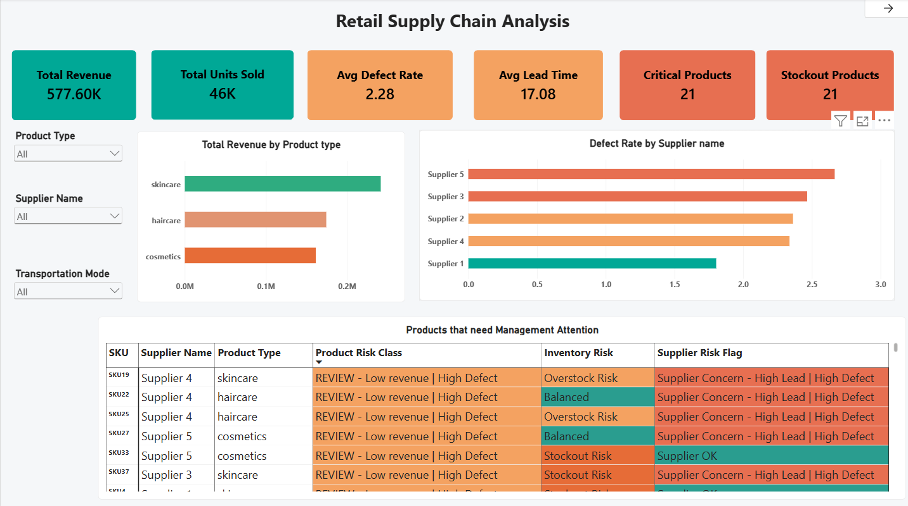
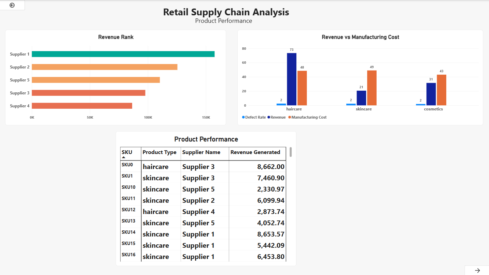
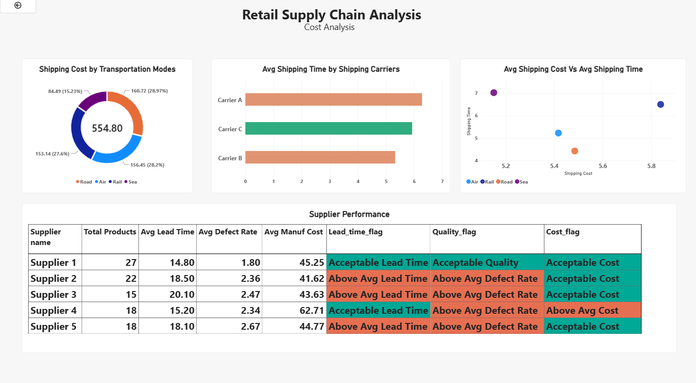

# Retail Supply Chain Performance Analysis

An end-to-end analysis of a retail supply chain dataset using **MySQL** and **Power BI**. The project looks at product performance, supplier quality, inventory risk, and delivery speed (lead time and shipping time) across suppliers, carriers, transport modes and locations.

## Business Questions

1. Which product types drive the most revenue and sales?
2. Which suppliers have higher defect rates or longer lead times?
3. Which products are at risk of overstock or stockout?
4. Which transport modes and carriers are fastest or slowest, and how do their shipping costs compare?
5. Which products and suppliers need management attention?

## Dataset

- File: `supply_chain_data.csv` (public supply chain dataset: add source link here)
- **100 rows, 24 columns**, one row per SKU
- 3 product types (skincare, haircare, cosmetics), 5 suppliers, 3 carriers, 4 transport modes (Road, Rail, Air, Sea), 3 routes, 5 locations (Mumbai, Kolkata, Delhi, Bangalore, Chennai)
- Data quality: no missing values and no duplicate SKUs

## Tools Used

- **MySQL**: data analysis using aggregations, subqueries, window functions and views
- **Power BI**: 3-page interactive dashboard

## Project Structure

```
retail-supply-chain-analysis/
├── README.md
├── supply_chain_data.csv
├── Retail_Supply_Chain_Analysis.sql
├── Retail_Supply_Chain_Analysis.pbix
├── executive_overview.png
├── product_performance.png
└── cost_analysis.png
```

## What I Did

### SQL
- Created the table and loaded the data, then checked record counts and distinct suppliers, carriers and locations.
- Calculated business KPIs: total revenue, units sold, average defect rate, average lead time, average shipping time and stock level.
- Analysed product, supplier, inventory and shipping performance using `GROUP BY`, subqueries, `CASE` logic, and window functions (`RANK`, `ROW_NUMBER`, `DENSE_RANK`).
- Built **7 reusable views** that feed the Power BI dashboard:
  `vw_product_performance`, `vw_inventory_risk`, `vw_supplier_performance`, `vw_logistics_performance`, `vw_cost_efficiency`, `vw_management_attention`, `vw_quality_analysis`.

### Power BI Dashboard (3 pages)
1. **Executive Overview**: KPI cards (total revenue, units sold, average defect rate, average lead time, critical products, stockout-risk products), revenue by product type, defect rate by supplier, a "Products that need Management Attention" table with risk flags, and slicers for product type, supplier and transportation mode.
2. **Product Performance**: revenue rank by supplier, a chart comparing revenue per unit, manufacturing cost and defect rate by product type, and a SKU-level product performance table.
3. **Cost Analysis**: shipping cost by transportation mode, average shipping time by carrier, average shipping cost vs average shipping time by mode, and a supplier performance table with lead time, quality and cost flags.

## Key Findings

- **Revenue:** total revenue is about 577,605 from 46,099 units sold. Skincare generates the most revenue (about 241,600), followed by haircare (about 174,500) and cosmetics (about 161,500).
- **Supplier lead time:** Supplier 3 has the longest average lead time (about 20.1 days) and Supplier 1 the shortest (about 14.8 days).
- **Shipping time by transport mode:** Sea is the slowest (about 7.1 days on average) and Road the fastest (about 4.7 days). Carrier A is the slowest carrier (about 6.1 days) and Carrier B the fastest (about 5.3 days).
- **Lead time by location:** Kolkata has the longest average lead time (about 19.4 days) and Delhi the shortest (about 14.6 days).
- **Supplier cost vs quality:** Supplier 4 has the highest average unit cost (about 62.7) and a slightly above-average defect rate. Supplier 1 has below-average cost and the lowest defect rate (about 1.8%), so it looks like the strongest supplier on this data.
- **Inspections:** 41 of 100 SKUs are still "Pending", 36 are "Fail" and 23 are "Pass", so quality results are incomplete.

## Assumptions and Limitations

- The dataset has only **100 rows**, and some supplier or product groups contain very few SKUs, so results should be treated as indicators and not firm conclusions. The data appears to be synthetic.
- `manufacturing_costs` is treated as a **cost per unit**, while `revenue_generated` is a **total**. Ratios that divide revenue by manufacturing cost (for example `revenue_to_manuf_cost_ratio`) compare a total with a per-unit value, so they should **not** be read as ROI or profit.
- The dataset does not explain the difference between `lead_times` and `lead_time`. In this project, `lead_time` is used as the supplier lead time and `lead_times` is kept but not analysed.
- The `costs` column is not defined in the dataset. It is used as-is in the cost views and not interpreted further.
- Risk flags (overstock, stockout, high defect) compare each SKU or supplier with the overall average. This is a simple screening method, not a forecast.
- There is no promised delivery date in the data, so actual "delay" cannot be measured; the project compares lead times and shipping times instead.

## How to Run

1. Create the database and table by running the script in `Retail_Supply_Chain_Analysis.sql`.
2. Import `supply_chain_data.csv` into the `supply_chain` table (for example with MySQL Workbench's Table Data Import Wizard).
3. Run the rest of the script to execute the analysis queries and create the views.
4. Open `Retail_Supply_Chain_Analysis.pbix` in Power BI Desktop. If Power BI asks for the data source, point it to your MySQL database or to the `supply_chain_data.csv` file.

## Screenshots

Dashboard screenshots:





## Possible Next Steps

- Replace revenue-to-cost ratios with unit price vs unit cost margin.
- Analyse lead time and shipping time by route and location in more detail.
- Repeat the analysis on a larger real-world dataset.

## Author

**Jerry A. Yonith Spenser**
[LinkedIn](https://www.linkedin.com/in/jerry-a-yonith-spenser) | [GitHub](https://github.com/Jerry171-hue)
